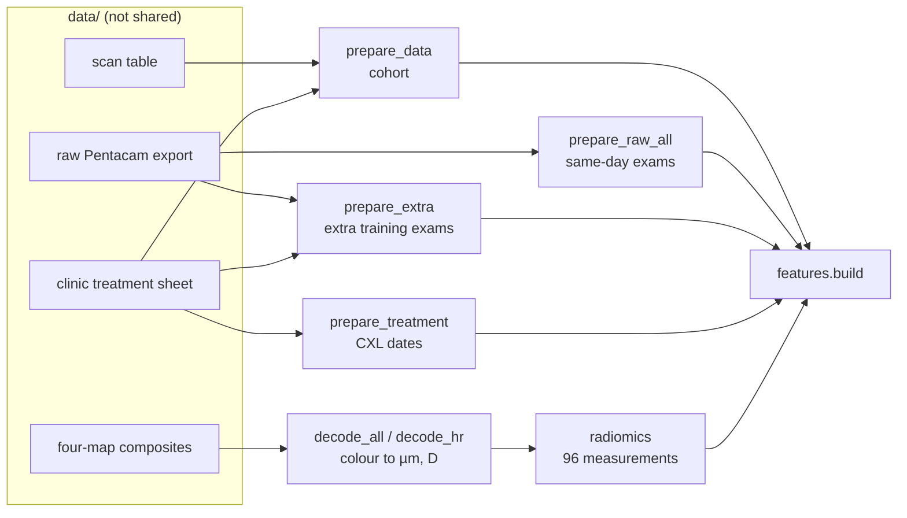
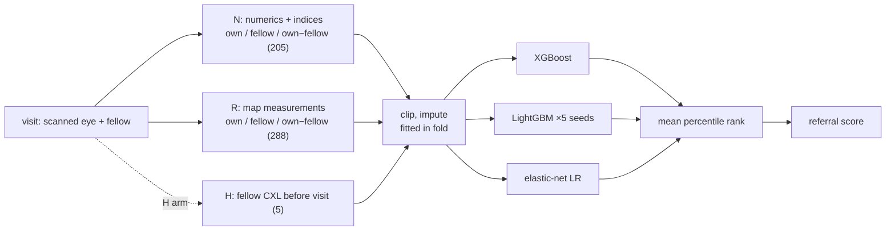

# Predicting referral for corneal cross-linking from a single Pentacam visit

From one visit, the model estimates the probability that a keratoconic eye will be referred for corneal
cross-linking (CXL). The visit contributes both eyes' Pentacam numerics, both eyes' four corneal maps, and age.

| arm | input | AUC, 944 scans | AUC, first visit (523 eyes) |
|---|---|---|---|
| **noH** (primary) | single visit | 0.768 [0.714–0.817] | **0.790** [0.744–0.835] |
| H (auxiliary) | + fellow-eye treatment before the visit | 0.813 [0.767–0.857] | **0.813** [0.770–0.854] |
| reference | age only | 0.661 [0.598–0.723] | 0.680 [0.621–0.734] |

AUCs come from 5-fold patient-grouped cross-validation, repeated 5 times. CIs are 95%, from a patient-cluster bootstrap.
The full method and all results are in [`publication_v2/report.html`](publication_v2/report.html).

## Data flow





## Run

```bash
pip install -r requirements.txt
export KC_SRC=/path/to/folder/with/data        # default: repository root
cd kcref
python -I prepare_data.py && python -I prepare_raw_all.py && python -I prepare_extra.py && python -I prepare_treatment.py
python -I decode_all.py && python -I decode_hr.py && python -I radiomics.py
python -I model.py cv noH        # 5 x 5 CV -> results/experiments.csv, results/oof/
python -I model.py cv H
python -I model.py freeze        # both arms on all scans -> frozen/final.pkl
python -I ../publication_v2/build_report.py
```

## Layout

| path | content |
|---|---|
| `kcref/common.py` | paths, numeric feature list |
| `kcref/prepare_*.py`, `decode_*.py`, `radiomics.py` | data preparation (cohort, fellow exams, extra exams, treatment dates, map decoding, block R) |
| `kcref/features.py` | visit rows, fellow lookup, blocks N, H, R, training rows |
| `kcref/model.py` | the blend: learners, in-fold tuning, CV entry point, freeze, `predict` |
| `kcref/evaluate.py` | repeated grouped CV, AUC with cluster-bootstrap CIs, paired deltas, run log |
| `kcref/staging.py` | stage definitions A (Km F) and B (Rm B) |
| `kcref/PROTOCOL.md`, `RESULTS.md`, `results/experiments.csv` | pre-declarations, experiment log, every configuration run |
| `kcref/archive/` | superseded experiments, kept for the record |
| `publication_v2/` | methods and results report, figures, tables |
| `preprocessing/` | cropping of the Pentacam composites |

Patient data (`data/`, `kcref/data/`, `kcref/frozen/`) is never committed. Every table is keyed by a salted-hash patient id.
